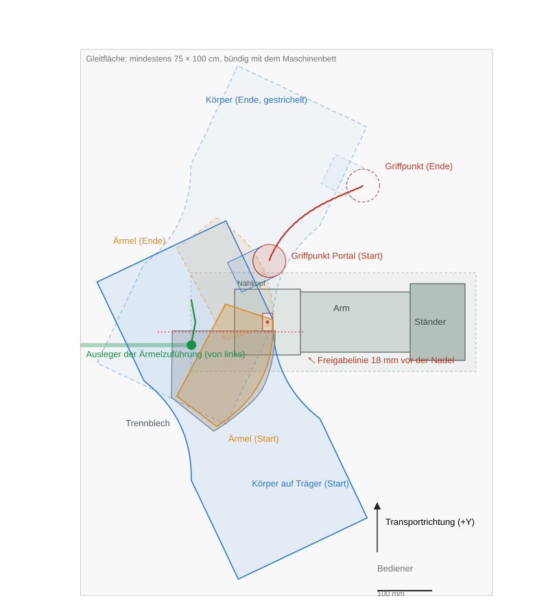
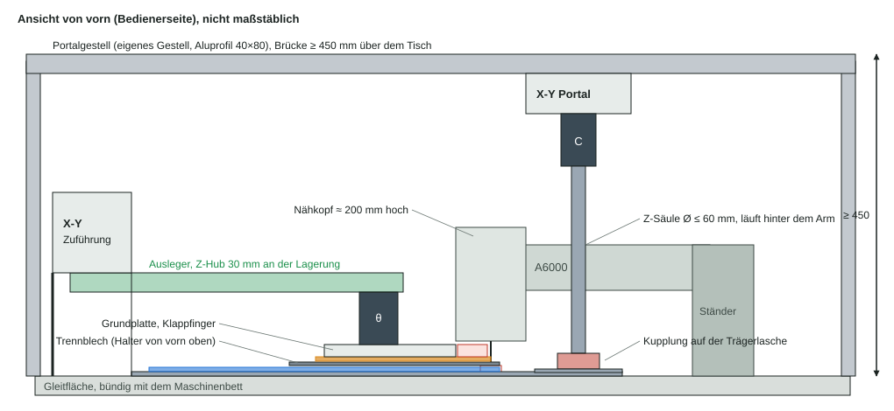
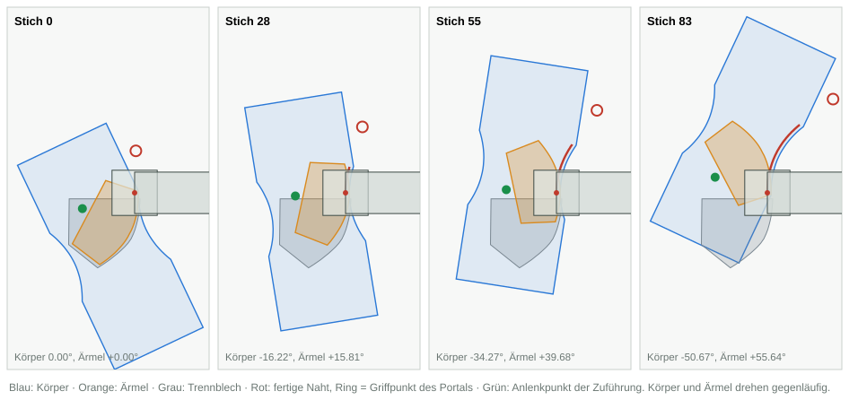
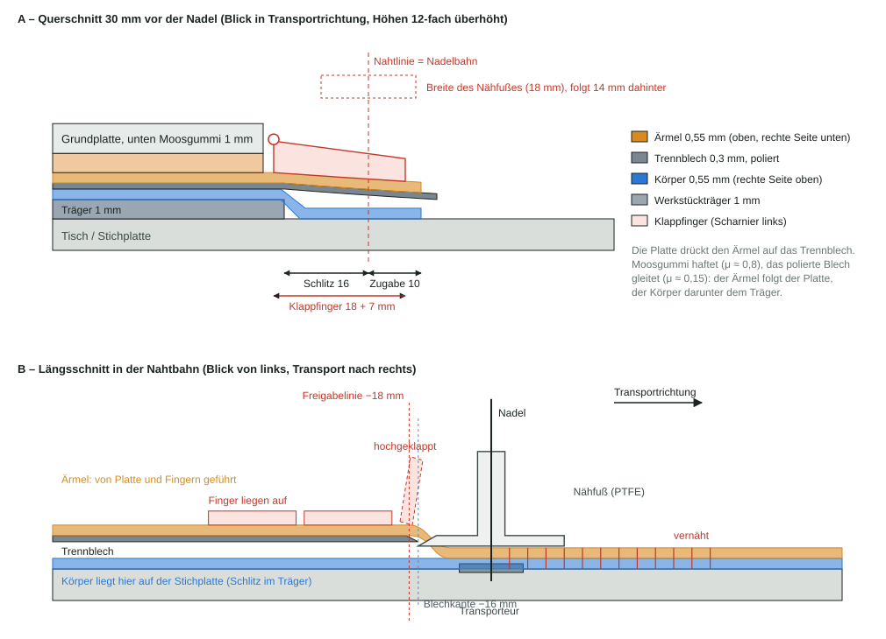
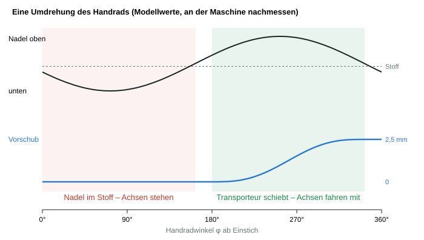
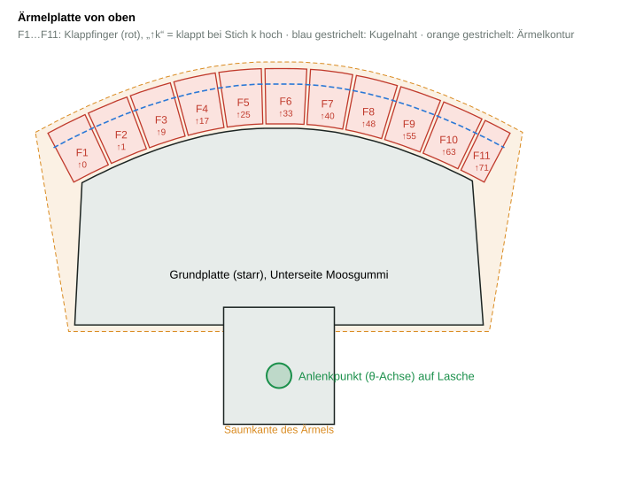
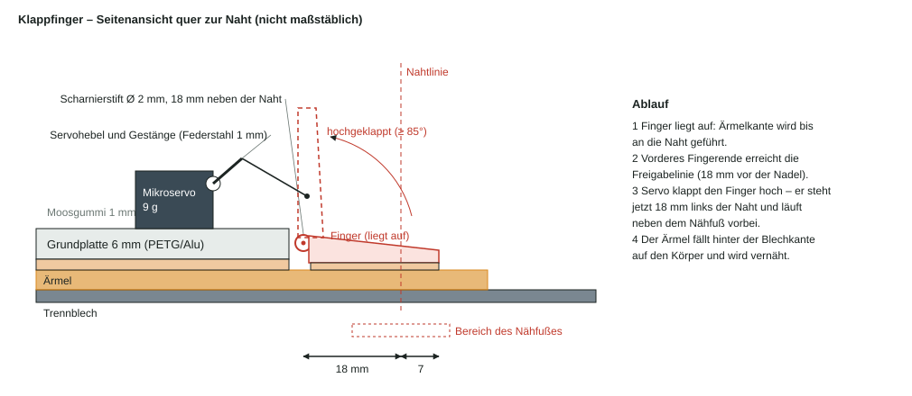
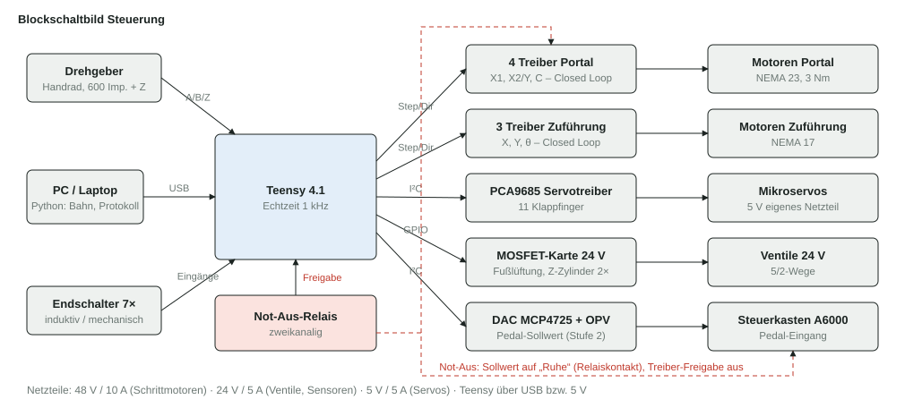

# Prototyp „Ärmel einsetzen“ an der Zoje A6000: Bauanleitung

Diese Anleitung beschreibt den Bau eines ersten Prototyps für das automatische Einsetzen eines
separaten Ärmels: Kinder-T-Shirt Gr. 86, Single Jersey, linkes Armloch. Das Prinzip ist
dasselbe wie im Szenario „T-Shirt, Ärmel einsetzen“ der Simulation:

- Ein Portal führt den Körper auf einem Werkstückträger um die Nadel.
- Eine Zuführung führt den Ärmel gegenläufig und bringt die Mehrweite ein.
- Ein Trennblech entkoppelt die beiden Lagen vor dem Nähfuß.

Alle Maße, Bahnen und Schaltzeitpunkte stammen aus dem Modell. Sie werden von drei Skripten
erzeugt:

| Skript | Ergebnis |
|---|---|
| `node tools/prototyp-export.mjs` | Zeichnungen 1:1, Bahntabelle und Kennwerte in [`prototyp/`](../prototyp), Abbildungen 1–4 |
| `node tools/prototyp-skizzen.mjs` | Prinzipskizzen (Abbildungen 5–8) |
| `node tools/einkaufsliste.mjs` | [Einkaufsliste](prototyp-einkaufsliste.md) und `prototyp/einkaufsliste.csv` |

**Inhalt**

0. [Ergebnis vorweg: Geht es mit der A6000?](#0-ergebnis-vorweg-geht-es-mit-der-a6000)
1. [Was gebaut wird](#1-was-gebaut-wird)
2. [Funktionsprinzip](#2-funktionsprinzip)
3. [Kritische Punkte](#3-kritische-punkte)
4. [Stufenplan](#4-stufenplan)
5. [Fertigungsunterlagen](#5-fertigungsunterlagen)
6. [Nähmaschine vorbereiten](#6-nähmaschine-vorbereiten)
7. [Gleitfläche und Gestell](#7-gleitfläche-und-gestell)
8. [Werkstückträger](#8-werkstückträger)
9. [Körperportal](#9-körperportal-x-y-c-z)
10. [Ärmelzuführung](#10-ärmelzuführung-mit-andruckplatte-und-klappfingern)
11. [Trennblech](#11-trennblech)
12. [Steuerung und Elektrik](#12-steuerung-und-elektrik)
13. [Einkauf](#13-einkauf)
14. [Inbetriebnahme](#14-inbetriebnahme-schritt-für-schritt)
15. [Messprotokoll](#15-messprotokoll-je-teil)
16. [Sicherheit](#16-sicherheit)

---

## 0. Ergebnis vorweg: Geht es mit der A6000?

**Ja, als Basis für den Prototyp.** Die A6000 ist eine Einnadel-Steppstichmaschine (Flachbett)
mit Direktantrieb, Untertransport, Nadelpositionierung und je nach Variante Fadenabschneider.
Was ihr fehlt, lässt sich von außen ergänzen:

| Anforderung aus der Simulation | A6000 | Lösung im Prototyp |
|---|---|---|
| Untertransport für den Körper | ja (Transporteur) | – |
| Obertransport mit Mehrweite für den Ärmel | **nein** | nicht nötig: Die Ärmelzuführung bringt die Mehrweite vor dem Fuß ein |
| gleichmäßige niedrige Drehzahl (400 Stiche/min) | ja, Direktantrieb, Höchstdrehzahl am Bedienfeld einstellbar | – |
| Nadelstopp oben/unten | ja (Bedienfeld) | – |
| automatische Fußlüftung | meist nein (Handhebel 5,5 mm, Kniehebel bis 13 mm) | Pneumatikzylinder am Kniehebelgestänge |
| Start, Stopp und Drehzahl vom Rechner | keine Schnittstelle | Pedal-Sollwert nachbilden (erst mechanisch, später elektrisch) |
| Stichsynchronisation (Nadelphase) | kein Signal nach außen | eigener Drehgeber am Handrad |
| Freiraum rechts der Nadel | ≈ 26 cm bis zum Ständer | reicht: Der Körper liegt links der Nadel und ragt nur 19 cm nach rechts |

**Zum fehlenden Obertransport** habe ich die Simulation eigens nachgerechnet (Option
`topFeed` im Modell), jeweils mit der im Prototyp baubaren Ärmelplatte aus Abschnitt 10:

| Variante | Stiche durch beide Lagen | Mehrweite (Soll 2,9 %) | Körpernaht | Ärmelnaht |
|---|---|---|---|---|
| ideale Platte, mit Obertransport | 83 / 83 | 2,8 % | Ø 0,30 mm, max. 1,6 mm | Ø 0,35 mm, max. 0,7 mm |
| ideale Platte, ohne Obertransport | 83 / 83 | 2,8 % | Ø 0,18 mm, max. 1,3 mm | Ø 0,43 mm, max. 1,0 mm |
| baubare Platte mit 11 Klappfingern, ohne Obertransport | 83 / 83 | 3,0 % | Ø 0,18 mm, max. 0,9 mm | Ø 0,44 mm, max. 1,4 mm |

**Wann auf eine andere Maschine wechseln?** Nur wenn Stufe 3 trotz PTFE-Fuß, reduziertem
Fußdruck und angepasstem Zuführverhältnis die Mehrweite nicht einhält (Abweichung > 1 %) oder
der Ärmel unter dem Fuß zurückbleibt. Dann braucht es eine Maschine mit **getrennt
einstellbarem Ober- und Untertransport**, zum Beispiel eine Steppstichmaschine mit
Differential-Obertransport wie die Juki DLU-5494N-7 oder einen Ärmeleinnähautomaten. Genaue
Typen vor dem Kauf nach Datenblatt prüfen. Der Rest des Prototyps bleibt gleich.

> **Vorher prüfen:** das vollständige Typenschild der Maschine (z. B. A6000-D-G/01,
> A6000-D-HG …). Davon hängen Stichlänge (5 oder 7 mm), Fadenabschneider und Nadelsystem ab.

---

## 1. Was gebaut wird



*Abbildung 1: Draufsicht, maßstäblich aus der Bahntabelle. Durchgezogen = Lage bei Stich 0,
gestrichelt = Lage bei Stich 83. Der Körper liegt links der Nadel und schwenkt 47 cm vor und
hinter die Nadel.*

| Baugruppe | Aufgabe |
|---|---|
| A6000 mit Fußlüftung, Pedal-Ansteuerung und Drehgeber | näht; liefert die Nadelphase |
| Werkstückträger (Platte mit Sprühkleber, Schlitz am Armloch, Lasche) | hält den Körper, bleibt beim Nähen unter ihm |
| Körperportal X-Y-C-Z | führt den Träger so, dass das Armloch an der Nadel immer in Transportrichtung liegt |
| Ärmelzuführung X-Y-θ-Z mit Andruckplatte und Klappfingern | führt den Ärmel gegenläufig mit Mehrweite |
| Trennblech | verhindert, dass der Körper den Ärmel vor dem Fuß mitnimmt |
| Steuerung (Teensy 4.1 + PC) | koppelt alle Achsen an die Nadelphase („elektronisches Getriebe“) |



*Abbildung 7: Ansicht von der Bedienerseite. Das Portal steht auf einem eigenen Gestell und
greift den Träger hinter dem Maschinenarm. Die Ärmelzuführung kommt mit einem Ausleger von
links.*

---

## 2. Funktionsprinzip



*Abbildung 2: Vier Zeitpunkte der Naht. Der Körper dreht sich um −51°, der Ärmel um +56°. An
der Nadel liegen beide Nähte in jedem Augenblick übereinander und zeigen in Transportrichtung.*

Körper und Ärmel haben gegensinnig gekrümmte Kanten. Liegen sie rechts auf rechts, decken sich
ihre Nahtlinien nur an einem Punkt: an der Nadel. Deshalb werden sie getrennt geführt.



*Abbildung 5: Schnitte durch die Nahtstelle. A: quer zur Naht, 30 mm vor der Nadel. B: längs
in der Nahtbahn.*

So wirken die Teile zusammen:

1. **Körper:** Er klebt auf dem Träger. Im Schlitz (16 mm ab Naht) liegt er frei auf der
   Stichplatte, damit Transporteur und Nähfuß arbeiten können.
2. **Trennblech:** Es liegt vor dem Fuß lose auf dem Körper und endet 16 mm vor der Nadel.
3. **Ärmel:** Er liegt auf dem Trennblech. Platte und Finger drücken ihn mit einem
   Moosgummibelag an. Der Belag haftet, das polierte Blech gleitet. Dadurch folgt der Ärmel der
   Platte und nicht dem Körper.
4. **Freigabe:** Hinter der Blechkante fällt der Ärmel auf den Körper. Dort hält ihn nichts
   mehr fest, er wird vernäht.
5. **Mehrweite:** Die Zuführung schiebt den Ärmel um bis zu 7 % schneller nach als der Körper
   läuft. Im Mittel sind es 2,9 %, verteilt auf den mittleren Kugelbereich.

---

## 3. Kritische Punkte

Dieser Abschnitt fasst zusammen, was die Umsetzung gefährden kann. Für jeden Punkt steht, was
belegt ist, wie man ihn früh prüft und was man tut, wenn er eintritt.

### 3.1 Was sich gegenüber der ersten Fassung geändert hat

Die erneute Prüfung hat fünf Fehler der ersten Fassung aufgedeckt. Alle sind in dieser
Fassung behoben:

| Fehler der ersten Fassung | Befund | Lösung jetzt |
|---|---|---|
| Portalachse und Trennblech | Die Senkrechtachse des Portals wäre bei 49 von 84 Stichen durch das Trennblech gelaufen | Trennblech nur so groß wie die vom Ärmel überstrichene Fläche; Griffpunkt hinter dem Maschinenarm |
| Griffpunkt unter dem Stoff | Der berechnete Griffpunkt lag mitten auf dem Vorderteil und war nicht zugänglich | Griffpunkt auf einer Lasche des Trägers, 40 mm außerhalb der Stoffkontur |
| Saugplatte mit „abhebenden Kammern“ | Plattenteile an der Naht laufen in Nähfuß und Fußstange; 5 mm abheben reicht nicht | Andruckplatte, die 18 mm neben der Naht endet, und Klappfinger, die neben dem Fuß vorbeilaufen |
| Tischgröße 90 × 70 cm | Der Träger überstreicht 50 × 94 cm, davon 47 cm hinter der Nadel | Gleitfläche mindestens 75 × 100 cm |
| Klettband als Nadelleiste | 1,5–2 mm dick, passt nicht unter das Trennblech (2 mm) | wieder ablösbarer Sprühkleber |

### 3.2 Risiken nach Gewicht

| Nr. | Risiko | Einschätzung | Beleg | Früher Test | Rückfallebene |
|---|---|---|---|---|---|
| K1 | **Führung des Streifens an der Naht.** Die Platte muss den Ärmel bis 18 mm vor die Nadel führen, darf aber nicht in den Fuß laufen | **hoch** | Simulation: Platte, die 20–30 mm vor der Naht endet, liefert nur 2,1 % bzw. 0,3 % Mehrweite und bis 10 mm Nahtfehler. Mit Klappfingern in 12 Varianten: 79–83 von 83 Stichen, Mehrweite 1,7–3,7 %, Ärmelnaht meist ≤ 2 mm | Stufe 3a: Finger von Hand hochklappen, Maschine am Handrad drehen | Finger schmaler (15 mm), Zuführverhältnis nachstellen; sonst Maschine mit Obertransport |
| K2 | **Fuß bremst den Ärmel.** Die A6000 hat keinen Obertransport | **hoch** | Simulation ohne Obertransport: 83/83. Das Fußmodell kennt aber nur „Fuß hält die obere Lage“ oder „nicht“ | Stufe 3: Passzeichen-Versatz nach der Naht messen | PTFE-Fuß, Fußdruck senken, Verhältnis +0,5–1 %; sonst Maschinenwechsel |
| K3 | **Gleichlauf Portal ↔ Transporteur.** Schiebt der Transporteur 2,4 statt 2,5 mm je Stich, zerren Portal und Transporteur am Stoff | mittel | nicht simuliert: Im Modell folgt der Roboter dem Transporteur ideal | Stufe 2: Stichlänge über 80 Stiche mit Träger und Stoff messen, Wert in die Steuerung übernehmen | nachgiebige Kupplung ± 1,5 mm in Y mit Wegsensor, die den Gleichlauf nachregelt |
| K4 | **Winkelgenauigkeit der C-Achse.** Der Griffpunkt liegt bis 304 mm von der Nadel entfernt; 0,1° Fehler ergibt dort 0,5 mm | mittel | Geometrie | vor dem Einbau: Messuhr 300 mm vom Drehpunkt, Umkehrspiel ≤ 0,1 mm | Drehtisch mit kleinerem Spiel (Harmonic-Getriebe) |
| K5 | **Rollkanten.** Single Jersey rollt sich an Schnittkanten ein | mittel | in der Simulation nicht enthalten | Stufe 2 und 3: Kante vor dem Fuß beobachten | Sprühstärke; Kanten vor dem Auflegen bügeln; Finger halten die Kante bis 18 mm vor die Nadel |
| K6 | **Reibschluss statt fester Bindung.** Die Simulation bindet den Ärmel starr an die Platte; real hält ihn nur die Reibung des Moosgummis | mittel | Abschätzung: nötig sind unter 0,5 N, verfügbar bei 3 N Andruck etwa 2 N | Stufe 3a: Platte von Hand verschieben, Ärmel muss ohne Schlupf folgen | mehr Andruck; feines Schleifpapier (P400) statt Moosgummi; Saugplatte |
| K7 | **Kollisionen hinter der Maschine.** Das Portal arbeitet 11–25 cm hinter der Nadel | mittel | Abstände berechnet: ≥ 51 mm zu Kopf, Arm, Trennblech und Zuführung. Die Maße von Kopf und Arm sind Annahmen | vor dem Bau: Kopf und Arm ausmessen, im Skript eintragen, neu rechnen | Garnständer versetzen, Kopfstütze abnehmen |
| K8 | **Gleitfläche.** Fugen, Scharniere und die Kante des Maschinenbetts können den Träger aufhalten | mittel | – | Stufe 2: Träger von Hand über die ganze Fläche schieben | PTFE-Band über alle Fugen; dünne durchgehende Deckplatte |
| K9 | **Pedal-Schnittstelle unbekannt.** Signalart und Stecker des Steuerkastens sind nicht dokumentiert | gering | – | Stufe 1 arbeitet mechanisch am Pedal und braucht die Schnittstelle nicht | bei Stufe 1 bleiben |
| K10 | **Drehgeber am Handrad.** Ein magnetischer Sensor kann vom Direktantrieb gestört werden | gering | – | – | optischer Drehgeber ist Standard in dieser Anleitung |
| K11 | **Nahtanfang.** Beim automatischen Start können die Fadenenden einziehen | gering | – | Stufe 1 | Fadenenden mit einer Federklammer halten; Sanftanlauf |
| K12 | **Auflegen von Hand.** In Stufe 3 legt man den Ärmel von Hand auf | gering | Simulation gleicht ± 5 mm über die Kamerakorrektur aus (Stufe 4) | – | Sollkontur auf dem Trennblech anzeichnen, Linienlaser |
| K13 | **Aufwand der Software.** Sieben Achsen, elf Servos und der Gleichlauf zur Nadel | mittel | – | Stufe 1 und 2 bauen die Software schrittweise auf | LinuxCNC mit Mesa-Karte statt eigener Firmware |

### 3.3 Was die Simulation nicht abdeckt

- Der Reibschluss der Platte, das Hochklappen der Finger als Mechanik und der Gleichlauf zum
  Transporteur sind als ideale Bindungen gerechnet.
- Rollkanten, Fadenspannung beim Anlauf und Schwingungen des Portals fehlen.
- Die Netzweite beträgt 1,5 cm. Millimeterwerte sind in der Fläche interpoliert.

Die Simulation zeigt also, dass das Prinzip aufgeht und welche Auslegungen sicher nicht
funktionieren. Ob die Mechanik es erreicht, zeigt erst der Prototyp.

---

## 4. Stufenplan

Jede Stufe hat ein messbares Ziel. Erst wenn es erreicht ist, geht es weiter.

| Stufe | Inhalt | Ziel / Abnahme | Aufwand (grob) | Kosten bis hier |
|---|---|---|---|---|
| **1** | Maschine vom Rechner starten, stoppen, Drehzahl vorgeben; Drehgeber; Fußlüftung | 83 Stiche gerade auf Probestreifen, Stichzahl exakt, Stopp Nadel unten | 1–2 Wochenenden | 330–700 € |
| **2** | Gleitfläche, Träger, Körperportal; Armlochnaht **ohne Ärmel** | Naht auf der Sollinie: Ø ≤ 0,5 mm, max. ≤ 1,5 mm | 4–6 Wochenenden | 1 350–2 900 € |
| **3a** | Trennblech, Platte und Finger; Ablauf **von Hand am Handrad** | Ärmel folgt der Platte ohne Schlupf, Finger laufen frei am Fuß vorbei | 2 Wochenenden | wie Stufe 3 |
| **3** | Ärmelzuführung angetrieben; Ärmel von Hand aufgelegt | 83/83 Stiche durch beide Lagen, Mehrweite 2–4 %, Ärmelnaht max. ≤ 2 mm | 3–5 Wochenenden | 1 850–4 100 € |
| **4** | Kamera-Lagekorrektur, Kantensensor | wie Stufe 3, mit ± 5 mm / ± 3° verlegtem Ärmel | 2–3 Wochenenden | 1 900–4 200 € |
| **5** | Versuchsreihe 20 Stück, Protokoll, Vergleich mit der Simulation | Streuung der Kennwerte; Liste der Abweichungen | 1–2 Wochenenden | – |

Stufe 3a ist neu. Sie prüft die beiden größten Risiken (K1 und K6) mit wenig Aufwand, bevor
die Antriebe der Zuführung gekauft werden.

---

## 5. Fertigungsunterlagen

Ordner [`prototyp/`](../prototyp):

| Datei | Inhalt | Verwendung |
|---|---|---|
| `schnittteile.svg` | Körper und linker Ärmel, Nähte gestrichelt, Passzeichen alle 50 mm | 1:1 drucken, Zuschnitt; Sollinie und Passzeichen übertragen |
| `traeger.svg` | Werkstückträger mit Schlitz am Armloch, Lasche und Griffpunkt | Zuschnitt in Polycarbonat 1,5 mm |
| `kalibrierplatte.svg` | Trägerkontur mit drei Nadellöchern auf der Naht | Einmessen des Portals |
| `trennblech.svg` | Trennblech in Maschinenkoordinaten, Lage zum Nähfuß | Zuschnitt in Federstahl 0,3 mm |
| `aermelplatte.svg` | Grundplatte, 11 Klappfinger mit Klappzeitpunkt, Anlenkpunkt | Konstruktion der Platte |
| `bahn_aermel.csv` | je Stich: Körperpose, Ärmelpose, Griffpunkt, Anlenkpunkt, Verhältnis, Zahl der hochgeklappten Finger | Sollwerte der Steuerung |
| `kennwerte.json` | Nahtlängen, Mehrweite, Wege, Abstände, Klappzeitpunkte | Parameter |
| `einkaufsliste.csv` | alle Kaufteile | Bestellung |

**Koordinaten** (Draufsicht, Ursprung = Einstichpunkt):
- X nach rechts (zum Ständer), Y nach hinten (Transportrichtung).
- θ gegen den Uhrzeigersinn von oben, Werte in mm bzw. °.
- Eine Pose ist die Lage des Schnittteil-Ursprungs (rotes Fadenkreuz in den Zeichnungen).
- Die Zeichnungen der Teile sind Draufsichten bei θ = 0, oben = hinten.

**Vor dem Bau:**
1. Kopf und Arm der eigenen A6000 in der Draufsicht ab Nadel ausmessen, einschließlich
   Fadenhebel, Fußstange und Kopfdeckel.
2. Die Werte oben in `tools/prototyp-export.mjs` eintragen (`HEAD`, `ARM`, `COLUMN_X`) und das
   Skript neu ausführen. Es wählt Griffpunkt und Anlenkpunkt dann neu.
3. Ausdrucke prüfen: Jede Zeichnung enthält eine 100-mm-Strecke.

**Kennwerte:**

| Größe | Wert |
|---|---|
| Armlochnaht / Kugelnaht | 208,0 / 214,0 mm (1 cm Zugabe) |
| Mehrweite | 2,88 %, Verhältnis im Kugelbereich bis 1,072 |
| Stiche bei 2,5 mm | 83 |
| Drehung Körper / Ärmel | −50,7° / +55,6° |
| Griffpunkt auf dem Träger | −170 / +200 mm vom Ursprung, auf einer 40-mm-Lasche |
| Weg des Griffpunkts | X +3 … +174 mm, Y +111 … +249 mm (hinter dem Arm) |
| größter Hebelarm Nadel ↔ Griffpunkt | 304 mm |
| kleinster Abstand der Portalachse zu Kopf, Arm, Trennblech, Zuführung | 51 mm |
| Anlenkpunkt der Ärmelplatte | 0 / +110 mm, auf einer Lasche hinter der Saumkante |
| Weg des Anlenkpunkts | X −139 … −132 mm, Y −42 … +41 mm |
| Träger überstreicht | X −311 … +187 mm, Y −469 … +467 mm |
| höchste Geschwindigkeiten bei 400 Stichen/min | Portal 24 mm/s, 6,4 °/s; Zuführung 17 mm/s, 9,4 °/s |

---

## 6. Nähmaschine vorbereiten

### 6.1 Einstellungen
- **Nadel:** System DB×1 (16×231), Nm 70–75, **Kugelspitze SUK** für Maschenware.
- **Garn:** Polyester-Umspinnzwirn Nm 120 in Ober- und Unterfaden, Kontrastfarbe zum Stoff.
- **Stichlänge:** 2,5 mm am Stellrad. Über 20 Stiche nachmessen (Soll 50 mm).
- **Fadenspannung:** so niedrig, dass der Verschlingungspunkt mittig im Zweilagen-Jersey liegt
  und nichts kräuselt.
- **Fußdruck:** an der Stellschraube oben am Kopf reduzieren, bis der Jersey gerade noch ohne
  Schlupf transportiert wird. Umdrehungen notieren.
- **Nähfuß:** Steppstichfuß mit PTFE-Sohle. Länge der Zehen vor der Nadel messen: Sie darf
  höchstens 16 mm betragen, sonst Freigabelinie und Blechkante im Skript anpassen.
- **Bedienfeld:**
  - Höchstdrehzahl 200 Stiche/min für die ersten Versuche, später 400.
  - Nadelstopp **unten**.
  - Anfangs- und Endriegel aus.
  - Sanftanlauf auf den kleinsten Wert.
  - Fadenabschneider in Stufe 1–3 aus.

### 6.2 Fußlüftung
- Unter dem Tisch sitzt das Kniehebelgestänge (Hub bis 13 mm am Fuß).
- Ein **Pneumatikzylinder Ø 25 mm, Hub 30 mm** drückt über einen Hebel auf die Kniehebelwelle.
  Ansteuerung über ein 5/2-Wegeventil 24 V, beide Anschlüsse mit Abluftdrossel.
- Hub mit einer Anschlagschraube so begrenzen, dass der Fuß **8 mm** hebt.
- Vorher mit einer Federwaage messen, welche Kraft der Kniehebel braucht. Der Zylinder liefert
  bei 4 bar rund 190 N.

### 6.3 Start, Stopp, Drehzahl vom Rechner
Das Pedal ist ein Sollwertgeber: Ruhe, vor = nähen, zurück = Fuß heben bzw. Faden abschneiden.

- **Stufe 1, ohne Eingriff in die Elektrik:** Ein kräftiges Modellbau-Servo bewegt das
  Originalpedal über eine Schubstange. Drei Stellungen einlernen: Ruhe, Nähen bei der am
  Bedienfeld eingestellten Höchstdrehzahl, Stopp. Die Drehzahl begrenzt das Bedienfeld.
- **Stufe 2, Sollwert elektrisch nachbilden** (nur Kleinspannungsseite):
  1. Steckverbindung Pedal ↔ Steuerkasten finden.
  2. Mit dem Multimeter Versorgung, Masse und Signal bestimmen.
  3. Signalspannung in Ruhe, bei leichtem und vollem Treten und beim Zurücktreten notieren.
  4. Teensy → DAC MCP4725 → Spannungsfolger → Signalleitung.
  5. Umschalter „Pedal / Rechner“ vorsehen.
  6. Der Not-Aus legt den Sollwert über einen Relaiskontakt hart auf „Ruhe“.

  **Den Steuerkasten nicht öffnen.** Er führt Netzspannung und den Motorumrichter. Der Eingriff
  kann die Gewährleistung berühren.
- **Prüfen, ob das Bedienfeld ein Festnaht-Programm hat** (Naht mit vorgegebener Stichzahl).
  Wenn ja, zählt die Maschine die 83 Stiche selbst und stoppt genau.

### 6.4 Drehgeber
- **Inkrementaler Drehgeber, 600 Impulse/U mit Nullimpuls**, koaxial am Handrad:
  3D-gedruckter Adapter auf der Handradmitte, flexible Wellenkupplung 6 × 6 mm, Halter am
  Maschinengehäuse oder am Tisch.
- Auswertung in Vierfachzählung: 2 400 Schritte je Umdrehung, also 0,15°.
- Kalibrieren durch langsames Drehen von Hand, jeweils den Winkel notieren:
  - Nadelspitze taucht in den Stoff ein / taucht aus,
  - Transporteur beginnt / beendet den Vorschub.
- Den **Vorschubverlauf** f(φ) messen: Messuhr an einem Probestreifen, alle 15° ablesen.



*Abbildung 4: Eine Umdrehung des Handrads mit den Werten des Modells. Die Achsen dürfen sich
nur im grünen Fenster bewegen. Die tatsächlichen Winkel der A6000 liefert die Kalibrierung.*

---

## 7. Gleitfläche und Gestell

- **Fläche:** Der Träger überstreicht 50 × 94 cm. Nötig ist eine durchgehende Gleitfläche von
  **mindestens 75 × 100 cm**: 34 cm links, 41 cm rechts, je 50 cm vor und hinter der Nadel.
  Ein üblicher Nähtisch (105 × 55 cm) ist dafür zu flach.
- **Erweiterungen:** beschichtete Platten vorn, hinten und links, bündig mit Tischplatte und
  Maschinenbett. Fugen und die Kante zum Bett mit PTFE-Glasgewebeband überkleben.
- **Hinter der Maschine prüfen:** Scharniere des Maschinenkopfs, Kopfstütze und Garnständer
  dürfen nicht über die Gleitfläche ragen. Kopfstütze abnehmen, Garnständer nach rechts
  hinten versetzen.
- **Gestell:** Portal und Zuführung stehen auf einem **eigenen Gestell** aus Aluprofil 40 × 40,
  das den Tisch überspannt. Die Tischplatte federt und die Maschine vibriert.
- **Höhe:** Unterkante der Brücke mindestens 450 mm über dem Tisch. Der Nähkopf ist rund
  200 mm hoch, darüber liegen Drehtisch und Hubzylinder.

---

## 8. Werkstückträger

- **Material:** Polycarbonat 1,5 mm, klar. Kontur nach `traeger.svg`, mit Lasche.
- **Oberseite:** wieder ablösbarer Textil-Sprühkleber. Dünn aufsprühen, 2 Minuten ablüften
  lassen. Er hält den Jersey flach und trägt nicht auf. Nach etwa 10 Teilen erneuern.
- **Unterseite:** PTFE-Folie, vollflächig.
- **Schlitz:** 16 mm ab Naht, nicht verkleinern. Sonst drückt der Nähfuß auf den Träger; das
  hat die Simulation beim Halsbündchen gezeigt.
- **Lasche und Kupplung:** Der Griffpunkt liegt 40 mm außerhalb der Stoffkontur.
  - Zentrierbohrung Ø 6 mm und Verdrehsicherung Ø 4 mm im Abstand 30 mm, beide mit Bohrbuchse.
  - Stahlscheibe Ø 25 mm für den Haftmagneten der Portalkupplung.
  - Der Träger liegt mit seinem Gewicht auf dem Tisch. Das Portal führt ihn nur in der Ebene.
- **Körper auflegen:** Sollinie und Passzeichen mit dem Trickmarker übertragen. Körper an zwei
  aufgezeichneten Marken ausrichten und von der Mitte nach außen glatt streichen.

---

## 9. Körperportal (X-Y-C-Z)

| Achse | Weg beim Nähen | Hub gesamt | Ausführung |
|---|---|---|---|
| X | 171 mm | 400 mm | Linearmodul mit Kugelgewindetrieb, Steigung 5 mm, Closed-Loop-Schrittmotor NEMA 23 |
| Y | 138 mm | 400 mm | wie X; die Brücke läuft auf der Gegenseite auf einer Profilschiene MGN15 |
| C | 51° | ± 180° | Hohlwellen-Drehtisch 10:1, Umkehrspiel ≤ 3 Winkelminuten |
| Z | – | 40 mm | pneumatischer Führungszylinder, hebt die Kupplung vom Träger |

- **Lage:** Der Griffpunkt arbeitet 11–25 cm **hinter** der Nadel, also hinter dem
  Maschinenarm. Die Bedienerseite bleibt frei.
- **Auflösung:** Kugelgewinde 5 mm, Geber 1 000 Striche: 1,25 µm je Schritt. Drehtisch 10:1:
  0,009° je Schritt.
- **Genauigkeit:** X und Y ≤ 0,05 mm, C ≤ 0,05° Umkehrspiel. Bei 304 mm Hebelarm entsprechen
  0,05° einem Fehler von 0,27 mm an der Nadel.
- **Schrittbetrieb:** Die Achsen fahren je Stich 2,5 mm in etwa 70 ms und stehen dann. Bei
  400 Stichen/min sind das 6,7 Bewegungen je Sekunde mit rund 2 m/s² Beschleunigung. Mit
  200 Stichen/min beginnen.
- **Z-Säule:** Durchmesser samt Kupplung höchstens 60 mm. Die Kollisionsrechnung nimmt diesen
  Wert an.

### 9.1 Einmessen mit der Kalibrierplatte
1. Kalibrierplatte statt des Trägers ankuppeln.
2. Portal fährt die Sollpose für Stich 0. Handrad von Hand drehen: Die Nadel muss in das Loch
   K1 eintauchen. Wenn nicht, X und Y nachstellen und den Versatz speichern.
3. Sollpose für Stich 83: Die Nadel muss in K3 eintauchen. Ein Fehler hier ist ein
   Winkelfehler der C-Achse. Nullpunkt der C-Achse korrigieren.
4. Sollpose für Stich 42: Kontrolle an K2. Abweichung ≤ 0,3 mm.

---

## 10. Ärmelzuführung mit Andruckplatte und Klappfingern



*Abbildung 3: Ärmelplatte von oben, maßstäblich. Die Grundplatte endet 20 mm neben der
Kugelnaht. Elf Klappfinger führen den Streifen an der Naht.*

### 10.1 Warum Finger nötig sind
Die Simulation hat drei Bauarten verglichen, jeweils ohne Obertransport:

| Bauart der Platte | Stiche | Mehrweite | Ärmelnaht max. |
|---|---|---|---|
| ideal: hält bis 18 mm vor die Nadel, über die ganze Breite | 83 / 83 | 2,8 % | 1,0 mm |
| starr, endet 16 mm neben der Naht | 76–83 / 83 | 1,2–3,4 % | 2,0–3,9 mm |
| starr, endet 20 mm neben der Naht | 82 / 83 | 2,1 % | 6,6 mm |
| starr, endet 30 mm neben der Naht | 83 / 83 | 0,3 % | 6,9 mm |
| Grundplatte + 11 Klappfinger (20 mm breit, 18 mm tief) | 83 / 83 | 3,0 % | 1,4 mm |
| Klappfinger 12–40 mm breit (12 Varianten) | 79–83 / 83 | 1,7–3,7 % | 0,8–4,7 mm |
| Klappfinger 25 mm tief | 81–83 / 83 | 3,8–6,1 % | bis 73 mm |

Folgerungen:
- Der Streifen an der Naht muss geführt werden. Eine einfache starre Platte genügt nicht.
- Fingerbreite 15–22 mm, Tiefe 18 mm. Tiefere Finger versagen.
- Die Mehrweite streut mit der Fingerteilung. Das Zuführverhältnis muss am Prototyp
  eingestellt werden.

### 10.2 Aufbau



*Abbildung 6: Ein Klappfinger im Schnitt quer zur Naht.*

- **Grundplatte:** Aluminium 5 mm oder PETG 6 mm, Kontur nach `aermelplatte.svg`. Unterseite
  mit Moosgummi 1 mm beklebt. Hinter der Saumkante trägt eine Lasche den Anlenkpunkt.
- **Klappfinger:** 11 Stück, 3D-Druck in PETG.
  - 20 mm breit, 25 mm lang: 18 mm bis zur Naht und 7 mm in die Nahtzugabe.
  - Scharnierstift Ø 2 mm, 18 mm neben der Naht, parallel zur Naht.
  - Unterseite Moosgummi 1 mm.
  - Je ein Mikroservo mit Metallgetriebe auf der Grundplatte, Gestänge aus Federstahldraht 1 mm.
  - Hochgeklappt steht der Finger senkrecht, 18 mm links der Naht, und läuft neben dem Fuß
    vorbei. Der Fuß ist 9 mm breit je Seite; es bleiben 9 mm Luft.
- **Klappzeitpunkte:** siehe `kennwerte.json`. Finger 1 ist von Beginn an oben, Finger 11
  klappt bei Stich 71. Die Spalte `finger_oben` der Bahntabelle nennt je Stich die Anzahl.
- **Höhe:** Die Platte liegt über den Ärmel auf dem Trennblech auf, mit 3–5 N Andruck. Den
  Z-Zylinder dafür auf niedrigen Druck regeln (0,5–1 bar) oder eine Druckfeder einsetzen.
- **Kein Vakuum.** Die Platte hält den Ärmel durch Reibung, nicht durch Unterdruck. Eine
  Saugplatte wird erst gebraucht, wenn die Zuführung den Ärmel selbst aus einem Magazin holt.

### 10.3 Achsen

| Achse | Weg beim Nähen | Hub gesamt | Ausführung |
|---|---|---|---|
| X | 7 mm | 150 mm | Linearmodul mit Kugelgewindetrieb, Closed-Loop-Schrittmotor |
| Y | 83 mm | 250 mm | wie X |
| θ | 56° | ± 90° | kleiner Hohlwellen-Drehtisch 10:1 am Ende des Auslegers |
| Z | – | 30 mm | Führungszylinder, hebt Platte und Drehtisch |

- Die X-Y-Einheit steht links neben der Gleitfläche auf dem Gestell. Ein Ausleger aus
  Alu-Rechteckrohr reicht über den Körper zum Anlenkpunkt.
- Der Anlenkpunkt bleibt mindestens 72 mm vom Nähkopf entfernt.

### 10.4 Ärmel auflegen (Stufe 3)
1. Platte angehoben, alle Finger oben.
2. Ärmel von Hand auf das Trennblech legen, rechte Seite nach unten. Die Sollkontur für
   Stich 0 ist auf dem Blech angezeichnet; zwei Linienlaser zeigen die Kugelnaht.
3. Platte senkt ab, Finger 2–11 klappen herunter.
4. Ab Stufe 4 misst eine Kamera die Lage und korrigiert die Startpose.

---

## 11. Trennblech

- **Material:** Federstahl 1.4310, 0,3 mm, blank. Oberseite polieren.
- **Kontur:** nach `trennblech.svg`. Sie entspricht der Fläche, die der Ärmel vor dem Fuß
  überstreicht, plus 8 mm Rand: etwa 22 × 20 cm, links vor der Nadel.
- **Hinterkante:** gerade, 16 mm vor der Nadel, 30° angefast und poliert.
- **Lage:** Das Blech liegt lose auf dem Körper. Es wird nur an der Vorderkante gehalten, von
  oben, damit der Träger darunter durchläuft.
- **Halter:** Alu-Flach von der Vorderkante des Gestells, zwei Rändelschrauben, in der Höhe
  einstellbar. Das Blech muss sich um 1–2 mm heben können.
- **Unterseite:** PTFE-Folie, damit der Körper darunter gleitet.
- **Anzeichnen:** die Kontur des Ärmels bei Stich 0 mit einem feinen Stift auf die Oberseite
  übertragen (Maße aus `bahn_aermel.csv`, erste Zeile).

---

## 12. Steuerung und Elektrik



*Abbildung 8: Blockschaltbild.*

### 12.1 Elektronisches Getriebe zur Nadel
Die Achsen fahren nicht nach Zeit, sondern nach **Transportweg**. Genau so führt die Simulation
den Roboter.

```
jede Millisekunde:
  φ, n  ← Drehgeber                         # Winkel und Umdrehungen seit Nahtbeginn
  s     ← (n + f(φ)) · Stichlänge            # f(φ): kalibrierter Vorschubverlauf 0…1 je Stich
  k     ← s / Stichlänge                     # Zeile der Bahntabelle (gebrochen)
  Soll  ← lineare Interpolation in bahn_aermel.csv bei k
            (greif_x, greif_y, koerper_theta, zufuehr_x, zufuehr_y, aermel_theta)
  Achsen ← Soll                              # Schritte erzeugen
  wenn k ≥ Klappstich von Finger i:  Servo i auf „oben“
```

- **Stichlänge:** Es zählt die **gemessene** Stichlänge mit Träger und Stoff, nicht der Wert
  am Stellrad (Risiko K3). Sie wird in Stufe 2 über 80 Stiche bestimmt.
- **Vorschub:** f(φ) ist außerhalb des Transportfensters konstant. Die Achsen bewegen sich
  nur, während der Transporteur schiebt.
- **Pegel:** Der Teensy arbeitet mit 3,3 V und verträgt keine 5 V an den Eingängen. Ausgänge
  zu den Treibern über Pegelwandler, Eingänge über Optokoppler.
- **Überwachung:**
  - Lageabweichung einer Achse über 0,3 mm: Sollwert auf „Ruhe“, Nadel unten.
  - Fehlende Drehgeber-Impulse bei Sollwert „Nähen“: Stopp.

### 12.2 Ablauf eines Zyklus
1. Träger mit Körper von Hand an die Kupplung legen; Z senkt ab, der Magnet hält.
2. Portal fährt den Nahtanfang 40 mm vor die Nadel und schiebt ihn unter den angehobenen Fuß.
3. Ärmel auflegen, Platte senkt ab, Finger herunter.
4. Fuß ab, 0,2 s warten.
5. Sollwert „Nähen“. Das elektronische Getriebe läuft bis 83 Stiche, dann Sollwert „Ruhe“.
6. Nadel hoch, Fuß hoch, restliche Finger hoch, Platte hebt ab und fährt zurück.
7. Portal fährt den Träger nach hinten heraus.

### 12.3 Alternative zur eigenen Firmware
LinuxCNC mit einer Mesa-Karte kann Achsen an einen Drehgeber koppeln und Schritte in Echtzeit
erzeugen. Die Bahntabelle wird dort als Kurventabelle hinterlegt. Das spart die Arbeit an der
Schritterzeugung, braucht aber Einarbeitung in die Konfiguration.

---

## 13. Einkauf

Die vollständige Liste mit 80 Positionen, Spezifikationen und Richtpreisen steht in
[prototyp-einkaufsliste.md](prototyp-einkaufsliste.md), als Tabelle in
`prototyp/einkaufsliste.csv`.

| Gruppe | Pflichtteile |
|---|---|
| A – Nähmaschine: Zubehör und Verbrauch | 58–115 € |
| B – Maschinenanbau: Fußlüftung, Pedal, Drehgeber | 135–324 € |
| C – Gleitfläche und Gestell | 237–438 € |
| D – Werkstückträger und Kalibrierplatte | 74–141 € |
| E – Körperportal | 491–1 126 € |
| F – Ärmelzuführung | 456–1 097 € |
| G – Trennblech | 23–52 € |
| H – Steuerung und Elektrik | 281–607 € |
| I – Pneumatik-Versorgung | 36–65 € |
| J – Messen, Einrichten, Stufe 4 | 103–226 € |
| **Gesamt** | **1 894–4 190 €** |

Optionale Teile (Kompressor, Laserzuschnitte, Zustimmtaster, Laser-Distanzsensor) kommen mit
328–733 € hinzu. Die Preise sind Schätzungen. Die untere Grenze gilt für Importware vom
Marktplatz, die obere für Markenware vom Fachhandel.

**Reihenfolge der Bestellung:** Die Spalte „ab Stufe“ erlaubt, schrittweise zu kaufen. Für
Stufe 1 genügen 330–700 €. Die Antriebe der Zuführung (Gruppe F) erst nach Stufe 3a bestellen.

---

## 14. Inbetriebnahme Schritt für Schritt

**Stufe 1**
1. Maschine nach 6.1 einstellen, Probenähte auf zwei Lagen Jersey. Stichlänge über 20 Stiche
   messen.
2. Fußlüftung anbauen, Fußhub auf 8 mm einstellen.
3. Drehgeber anbauen, Nadel- und Transportwinkel kalibrieren, Vorschubverlauf messen.
4. Pedal-Stellantrieb anbauen. 83 Stiche nach Zählung des Drehgebers, Stopp Nadel unten.
   Zehnmal wiederholen: Die Stichzahl muss jedes Mal stimmen.

**Stufe 2**

5. Gleitfläche bauen. Träger von Hand über die ganze Fläche schieben: nichts darf haken.
6. Portal aufbauen. Mit der Messuhr Umkehrspiel und Wiederholgenauigkeit je Achse messen.
   C-Achse: Messuhr 300 mm vom Drehpunkt, Ziel ≤ 0,1 mm.
7. Mit der Kalibrierplatte einmessen (9.1).
8. Bahn mit stehender Maschine abfahren, Handrad von Hand drehen. Der Nähfuß bleibt immer im
   Schlitz, die Z-Säule berührt nichts.
9. Körper auf den Träger, Naht bei 200 Stichen/min. Stichlänge über 80 Stiche messen und in
   die Steuerung übernehmen. Dann Abweichung von der Sollinie an 10 Stellen messen.

**Stufe 3a**

10. Trennblech einbauen. Träger mit Körper von Hand darunter durchschieben.
11. Platte mit Fingern an einem festen Halter über das Blech setzen. Ärmel auflegen, Platte
    von Hand verschieben: Der Ärmel muss ohne Schlupf folgen, der Körper darunter liegen
    bleiben.
12. Maschine am Handrad drehen, Finger von Hand nacheinander hochklappen. Sie laufen frei am
    Fuß vorbei.

**Stufe 3**

13. Zuführung aufbauen, Bahn trocken abfahren.
14. Ärmel mit Passzeichen annähen. Messen:
    - Stiche durch beide Lagen (von der Rückseite zählen),
    - Versatz der Passzeichen (zeigt die Verteilung der Mehrweite),
    - Abstand Ärmelnaht ↔ Kugelnaht-Linie.
15. Zuführverhältnis in Schritten von 0,5 % nachstellen, bis die Passzeichen treffen.

---

## 15. Messprotokoll (je Teil)

| Größe | Soll (Simulation, Klappfinger, ohne Obertransport) | Messung |
|---|---|---|
| Stiche durch beide Lagen | 83 / 83 | |
| Abweichung Körper Ø / max. | ≤ 0,2 / ≤ 0,9 mm | |
| Abweichung Ärmel Ø / max. | ≤ 0,45 / ≤ 1,4 mm | |
| Mehrweite gesamt | 3,0 % (Soll 2,9 %) | |
| Versatz der Passzeichen | ≤ 2 mm | |
| Falten in der Naht | keine | |
| gemessene Stichlänge | 2,5 mm | |
| Zykluszeit Nähen | ≈ 12,5 s bei 400 Stichen/min | |

Abweichungen von der Simulation sind die eigentlichen Ergebnisse des Prototyps. Mit ihnen kann
das Modell nachgeschärft werden: Reibwerte, Fußbremse, Biegesteifigkeit des Jerseys.

---

## 16. Sicherheit

- Nähmaschine und Achsen nur mit **Not-Aus in Griffweite** betreiben. Der Not-Aus schaltet den
  Pedal-Sollwert auf Ruhe und die Achstreiber stromlos.
- Beim Einrichten alle Achsen auf ≤ 20 mm/s begrenzen.
- Hände nie im Bereich von Nadel und Fuß, solange die Steuerung aktiv ist. Ein Zustimmtaster
  hilft bei den Testläufen.
- Pneumatik mit dem Druckregler auf das Nötige begrenzen (Fußlüftung 3–4 bar).
- Für einen Prototyp im Eigengebrauch reicht diese Grundabsicherung. Wird die Anlage von
  Dritten bedient oder weitergegeben, gelten Maschinenrichtlinie bzw. Maschinenverordnung mit
  Risikobeurteilung und Schutzeinrichtungen.

---

*Zugehörige Simulation:* Szenario „T-Shirt, Ärmel einsetzen“ ([aermel-einsetzen.md](aermel-einsetzen.md)).
Die Varianten der Ärmelplatte lassen sich über die Optionen `feederSlot`, `feederCell`,
`feederFingerW`, `feederFingerDepth` und `topFeed` der Simulation nachrechnen.
